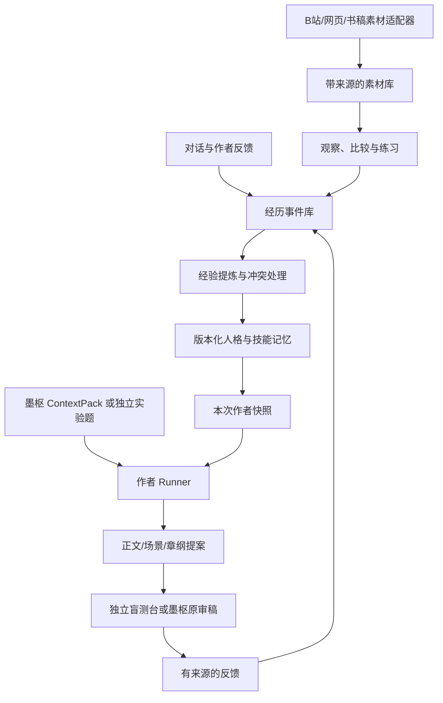

# 独立 AI 作者核心：论文调研、dsh-fish 复用与项目推进建议

日期：2026-11-06。状态：研究与设计建议，尚未实现作者引擎或进行真实模型写作实验。

## 1. 推荐决策

先独立建设一个能够学习、查资料、积累创作经验和输出正文的作者运行时，再通过版本化接口接入墨枢。作者运行时负责创作；墨枢负责作品数据、章纲、版本管理、审稿与定稿。独立实验台中的评估器只用于研发测量，不替代墨枢审稿。

第一阶段的“训练”使用外部记忆、检索、反馈和技能沉淀，不更新模型权重。积累可靠的原创训练样本、偏好对和盲测收益以后，再判断是否做 SFT/LoRA/DPO。接入一个第三方模型 API，不会因为本地记忆变多而自动改变模型参数。

真正要验证的假设有三个：

1. 经历和记忆能否形成稳定、可解释的创作倾向？
2. 这些倾向能否改善文笔、人物选择与情节安排，而非仅改变聊天口吻？
3. 改善能否延续到未见题目和连续多章，且成本可接受？

“像一个人”“人格测评稳定”“篇幅很长”和“小说写得好”分别测量，不能互相替代。目前没有查到足以证明“培养一个人格就能稳定成为高水平中文网文作者”的直接证据。

## 2. 论文证据与适用范围

本轮核验了一批与设计直接相关的 2022—2025 年原始论文页面，部分阅读了 HTML 全文；这是针对项目的起步文献集，不是截至 2026 年的穷尽检索。论文结果属于各自的数据集、模型和实验设置，不能把其中的提升百分比直接当成本项目收益。

### 2.1 人格、记忆与成长

| 文献 | 可借鉴机制 | 用在项目中的位置 | 证据边界 |
|---|---|---|---|
| [Generative Agents, 2023](https://arxiv.org/abs/2304.03442) | 经历流；按相关性、时间和重要性召回；从经历反思；再规划行动 | 人格核心总体结构 | 主要研究行为可信度和小镇社会模拟，不是文学质量或意识；核验摘要及全文相关章节 |
| [MemGPT, 2023](https://arxiv.org/abs/2310.08560) | 将有限上下文与外部长期存储分层管理 | 工作记忆与长期记忆分离 | 上下文管理能改善可用记忆，不能证明文笔提升；核验论文摘要 |
| [MemoryBank, 2023](https://arxiv.org/abs/2305.10250) | 记忆衰减、强化、用户画像更新 | 可变化的偏好和召回排序 | 遗忘曲线是工程机制；不得用于删除作品正史；核验论文摘要 |
| [A-MEM, 2025](https://arxiv.org/abs/2502.12110) | 原子记忆笔记、标签、关联链接、记忆演化 | 连接读书观察、写作练习和反馈 | 主要实验是会话记忆；第一版可用表和关联关系，无需照搬图数据库；核验摘要及全文机制 |
| [Reflexion, 2023](https://arxiv.org/abs/2303.11366) | 利用任务反馈形成语言化经验，不更新模型权重 | 练习→反馈→经验→下一次应用 | 编程、推理等结果不能直接外推小说；关键是有反馈，而非只写日记；核验论文摘要 |
| [RoleLLM, 2023](https://arxiv.org/abs/2310.00746) | 区分角色知识、表达风格、角色条件微调 | 后期角色语气或作者风格数据建设 | 角色模仿不等于作者创作能力；核验论文摘要 |
| [Character-LLM, 2023](https://arxiv.org/abs/2310.10158) | 用角色经历数据训练角色模型 | 真正进行参数训练时参考 | 证明特定角色模拟路线可研究，不能证明独立思想、意识或文学创作水平；核验论文摘要 |
| [PersonaGym, EMNLP Findings 2025](https://aclanthology.org/2025.findings-emnlp.368/) | 跨不同情境评估人格行为一致性，而非只测自我描述 | 人格回归测试 | 人格分数不是文学分数；论文也提示更大的模型未必更忠于人格；核验官方页面与摘要 |
| [InCharacter, 2023](https://arxiv.org/abs/2310.17976) | 用访谈评估角色人格保真度 | 辅助检查长期人格漂移 | 不能用一份心理量表判定作者写作水平；核验论文摘要 |

### 2.2 记忆评估、故事生成与写作质量

| 文献 | 可借鉴机制 | 对本项目的含义 | 证据边界 |
|---|---|---|---|
| [LongMemEval, 2024](https://arxiv.org/abs/2410.10813) | 信息抽取、多轮整合、时间推理、知识更新和不知道时不编造 | 必须测试旧偏好失效、来源召回、时间过滤和未知问题 | 不能只把历史全部塞进长上下文；核验摘要及全文检索/读取章节 |
| [LoCoMo, 2024](https://arxiv.org/abs/2402.17753) | 多会话、长期事件与因果记忆测试 | 建设作者成长回放集 | 会话记忆成绩不代表长篇小说连续性；核验论文摘要 |
| [Re3, 2022](https://arxiv.org/abs/2210.06774) | 总体计划、按当前故事状态递归提示、筛选与修订 | 正文作者仍需要章纲、进度与前情；人格不能代替规划 | 使用较早模型、较短长篇实验；核验论文摘要 |
| [DOC, 2022 预印本](https://arxiv.org/abs/2212.10077) | 细化层级大纲并控制正文遵循大纲 | 继续采用墨枢章纲/场景输入；人格主要决定表现方式 | 原论文包含训练过的控制器，不能认为加一段提示词就复现其收益；核验摘要及全文结构 |
| [Dramatron, 2022 预印本](https://arxiv.org/abs/2209.14958) | 标题、人物、节拍、地点、对白分层生成，并请行业人士参与评估 | 独立实验台可以先做结构规划和短场景，再扩到整章 | 主要是剧本共创，不是自动连载网文；核验论文摘要 |
| [WritingBench, 2025](https://arxiv.org/abs/2503.05244) | 根据具体题目建立评估标准，而非所有作品用同一张分数表 | 对不同题材、情绪目标、篇幅分别评估 | 广义写作基准；自动评分仍需本人的盲评校准；核验摘要及全文评估设计 |
| [LongWriter, 2024](https://arxiv.org/abs/2408.07055) | 分解长输出任务；用长输出数据进行训练 | 写得长需要独立设计，不由输入上下文长度决定 | 长输出成绩不等于多章因果、思想或文学质量；核验论文摘要 |
| [Generative AI enhances individual creativity but reduces the collective diversity of novel content, Science Advances 2024](https://doi.org/10.1126/sciadv.adn5290) | 在短篇创作实验中观察 AI 辅助与作品趋同现象 | 评估方案多样性，防止所有人物和冲突都写成同一套 | 人类使用 AI 点子的实验；不直接证明本系统必然趋同；核验出版元数据和出版方摘要 |

补充：

- [Self-Refine, 2023](https://arxiv.org/abs/2303.17651)：生成—反馈—修订可不依赖参数训练，但其任务收益不能机械迁移。
- [Large Language Models Cannot Self-Correct Reasoning Yet, 2023](https://arxiv.org/abs/2310.01798)：讨论缺少外部反馈的推理自纠正局限；用来提醒我们独立测量反馈价值，不是断言所有文学自修都无效。
- [LoRA, 2021](https://arxiv.org/abs/2106.09685)、[DPO, 2023](https://arxiv.org/abs/2305.18290)：后期适配技术候选。LoRA 是参数高效适配方法，不是人格算法；DPO 利用偏好数据，也不创造可靠偏好标签。

## 3. dsh-fish 实际核验与复用边界

### 3.1 固定研究基线

本次补查的源码提交为 [889ec982849fdea5e469f2d473723e81f2f55fe4](https://github.com/ssamurias/dsh-fish/tree/889ec982849fdea5e469f2d473723e81f2f55fe4)。该提交 package.json 标为 `@ssamurias/dsh-fish`、`0.9.0`，而 CHANGELOG 把 0.9.0 标为“未发布”；不能把它当成已发布稳定版。前一轮研究基线是 0.8.8，不能混用两版行为。

重要变化：0.9.0 开发记录加入主动性、兴趣、好奇和梦等机制；去掉了“让她去刷 B 站”那条唤醒驱动路径，`browse.enabled` 默认关闭，但 `bili_look` / `bili_watch` 工具仍保留。官方记录本身也存在参数描述与实现数值不完全一致的情况，例如 drive 阈值，以固定提交的代码为准。

源码许可证为 MIT。抽取代码时保留 LICENSE、版权及来源记录；另建 `upstream-manifest.json` 记录提交、文件、修改说明，不追随 main 自动升级。墨枢与未来独立仓库各自的许可证仍需分别保留。

### 3.2 模块清单

| 上游模块 | 复用方式 | 必须调整的内容 |
|---|---|---|
| `store.js`、`schema.js` | 借鉴只追加事件、派生快照、重放、字段校验 | 改成独立存储接口；不沿用 `~/.dsh-fish`、主人身份和全局单实例假设 |
| `derive.js`、`stance.js` | 抽取事件→当前判断/立场的思路和可测纯函数 | 拆出信任/拒绝/关系阶段；字面相似度和否定词检测只作为候选检测，不能当语义真相 |
| `persona.js` | 借鉴按预算编译身份摘要 | 作者身份、学习偏好、工作方式、写作风格分区；清除陪伴特定禁令 |
| `recall.js` | 借鉴有来源、时间、片段预算的回忆工具 | 加来源可靠性、工程版本、小说项目、章节时间截断及语义检索 |
| `interest.js`、`curiosity.js`、`drive.js` | 作为兴趣和信息缺口调度的起点 | 用写作问题、训练反馈和知识缺口驱动；限制后台成本，不把活跃次数当进步 |
| `bili.js`、`browse.js`、`video.js` | 把读取、排名、限流、熔断、抽帧封成素材适配器 | 与人格存储及 DSH 宿主解耦；真实平台兼容性另测 |
| `capture.js` | 借鉴受控追加与引用检查 | 重写作者事件 API；模型不能自行伪造人类采纳、盲评成绩或作品定稿 |
| `identity.js`、`home.js`、`turns.js`、`index.js` | 不整块搬入新核心 | 与 DSH system prompt、会话、轮次和生命周期耦合，改写为本项目自己的 Runner/接口 |
| `client.js`、`selfupdate.js`、陪伴阶段/拒绝/疤机制 | 第一版不移植 | 不是写作能力的必要条件；不要把“拒绝过两次”当成成为好作者的门槛 |

建议采用“独立作者运行时＋少量抽取模块”，不把整个插件装进墨枢，也不为运行插件重建一个 DSH 宿主。保留一份未修改的源码对照包用于研究，改造代码只进入新项目并明确记录派生关系。

### 3.3 已做验证及未做验证

对固定提交运行以下上游测试文件：`derive`、`stance`、`recall`、`schema`、`browse`、`video`。

结果：99 项，96 通过，0 失败，3 跳过。3 项跳过来自本机缺少 ffmpeg 的视频管道实测。这里只验证选中的上游模块，没有运行上游全套测试，没有登录或访问真实 B 站账号，没有证明真实抽帧、字幕或实时搜索可用，也没有测试接入墨枢后的质量。

## 4. 独立核心的架构



第一版采用 Node.js/TypeScript，与墨枢技术栈一致；SQLite 存事件、任务和快照，全文检索先行，中文语义召回收益明确后再接向量检索。不要同时引入多个竞争的记忆系统和图数据库。模型通过 `ModelPort` 可替换；研究采集通过 `SourcePort`；作品输入通过 `ContextPack`。

独立项目建议结构：

```text
author-core/
  packages/contracts/          # JSON Schema、版本与公共类型
  packages/core/               # 事件、记忆、身份编译、写作 Runner
  packages/connectors/         # 模型、网页、B站适配器
  apps/lab/                    # CLI 起步：培养、试写、对比、回放
  apps/server/                 # HTTP 任务接口和流式进度
  evals/                       # 冻结题集、盲评和成长回归
  upstream/                    # 来源清单、许可和必要抽取代码
```

命令入口可围绕 `ingest`、`learn`、`practice`、`draft`、`evaluate`、`snapshot`、`replay` 设计。先跑通一次完整实验，再建设复杂聊天界面。

## 5. 人格、知识和文风怎样共同工作

### 5.1 六种记忆分开存，最终可以合并成作者表达

| 记忆 | 内容 | 更新方式 |
|---|---|---|
| 经历记忆 | 读过什么、做过什么练习、收到什么反馈 | 原始记录追加；错误用更正事件连接 |
| 知识记忆 | 某来源说了什么、可核验的事实与观点 | 来源、时间、有效期、互相支持/反驳关系 |
| 作者立场 | 感兴趣的问题、偏爱的冲突与价值取舍 | 有证据的变化，可保留并存的张力 |
| 创作技能 | 如何制造潜台词、安排信息差、设置代价 | 保留适用条件、失败例和实测反馈 |
| 文风档案 | 视角、句式、段落、对白、范例与反例 | 结构化更新和版本控制 |
| 作品上下文 | 小说设定、人物状态、已发生事件和未来计划 | 由当前作品输入，独立于作者人格 |

作者自己的立场不等于小说角色的立场，更不能让所有人物用同一种口气说话。核心可偏好“代价真实”，但不应强迫每次情节都牺牲一个人。思想水平要通过两难选择、合理反方和后果呈现衡量，不奖励旁白说教。

作者基础身份可以先由用户讨论和少量样章确定，再在经历中变化。没有必要坚持完全空白出生；这是一项产品选择，并非论文要求。人格和文风在存储上分开，在写作提示中组成一致作者身份。

### 5.2 成长不等于重复强化

不沿用“反复说三次就更正确”的逻辑。应区分：

- 显著性：最近是否重要、是否常被想起。
- 偏好强度：作者是否持续作同类选择。
- 事实可信度：来源和证据是否可靠。
- 技能有效性：在不同未见任务中是否真的改善结果。

AI 自己写十遍“动作更重要”不能变成十份独立证据；转载同一篇文章也不能算多个来源。用户偏好可能很强但未必是客观写作法则。一次失败也不能使人格整体翻转。

技能记忆建议形式：

```text
技能：把设定信息嵌入交易冲突
适用：人物需要按规则买卖、谈判或付代价
做法：先让双方出现目标冲突，再让限制改变一次选择
反例：双方都知道规则，却为了向读者解释而轮流背说明书
不适用：本章故意采用档案体或说明体
证据：练习 P014 的原稿、改稿、人类评价
状态：候选 / 已验证 / 待复查
```

## 6. 上网、B站和自主学习

保留自主兴趣，但让行为具有可解释的学习闭环：

```text
发现问题 → 自选资料 → 阅读/观看 → 记录观察
→ 对比不同解释 → 做原创练习 → 接收反馈 → 更新经验
```

用户可以递一个链接；核心也可以在设定时段和预算内自行搜索与浏览，自动记录观察和低风险候选经验。无需每读一条内容都等人批准。关键身份变化形成版本记录，重要经验通过后续练习验证；用户可以更正、回退或分叉作者快照。

浏览主题可以分为写作方法、现实生活观察、历史科学素材、影视叙事，以及少量自由探索。只刷“爆款写法”容易使输出趋同。兴趣应能保留非即时功利的内容，但后台任务要受时长、请求和 token 上限约束，正在写作时可以暂停背景学习。

需要纠正前面讨论中一个过于乐观的描述：不能把 dsh-fish 视作现成、稳定的 B站字幕阅读器。固定提交的 `bili.js` 明确说明早期读取主要依靠标题、简介、标签、热评和弹幕，并不依赖字幕。`video.js` 通过视频流和 ffmpeg 抽取少量帧，配合支持图像输入的模型才构成画面理解；这不等于看完视频或听过音频。

每条素材记录明确标注已获得的证据：

- 元信息与评论：只能说“读过相关文字”，不能写成“观看完整视频”。
- 字幕：取得文本及时间轴以后才能引用；无字幕就是缺失。
- 抽帧：记录具体时刻，只支持对这些画面的观察。
- 音频转写：以后通过独立适配器接入，记录覆盖范围和识别不确定性。

素材工具返回正文数据和来源，不获得修改任务规则、调用凭据或直接写入人格定论的权限。Cookie 留在连接器，不能进入模型上下文和实验导出。第三方言论、AI 推断、亲身交互、故事虚构和已定稿事实分别标注；想象与梦可以产生创作提案，不能伪装成真实经历。

训练数据使用自有、明确授权或可合法使用的材料；学习结构和技法时生成原创练习，避免把无权使用的完整作品批量变成训练语料。相似内容按来源族去重，保留引用与贡献记录。

## 7. 独立培养路线

### 第一阶段：外部记忆学习

冻结一个基础模型版本，先建立可追溯的作者快照和训练台。每天不必训练；以一次完整“学习—练习—反馈—复试”为学习单位。

| 能力 | 练习 | 反馈标准 |
|---|---|---|
| 文笔 | 同一场面写克制、紧张、轻松三个版本；修订一个有明确缺陷的段落 | 措辞精确、动作空间清楚、感官有功能、语气符合任务 |
| 人物 | 同一困境下给不同人物不同选择 | 动机可追溯、代价可信、声音有区别 |
| 思想 | 同一事件构造双方最有力的理由，再写行动与后果 | 真正冲突、复杂性、具体后果，避免标签化和说教 |
| 情节 | 为同一个章纲提出三种因果机制和后续代价 | 不靠巧合补洞、反派有行动能力、悬念与回收相关 |
| 长程安排 | 连续写 10 章，再扩到 30—50 章 | 角色所知边界、伏笔、转折铺垫、持续推进与避免重复 |

用户指出一次问题时，记录“原稿—改稿—原因—适用条件”，不能只存最后的好稿。AI 可以自评，但自己的夸奖不算达标。自动评估器只筛选和辅助诊断，重大改进由盲测确认。

### 第二阶段：必要时进行参数训练

只有在外部记忆方案已可复现实验，并发现稳定的模型能力瓶颈时才启动。

- SFT/LoRA：学习高质量章纲→场景/正文、反馈→修订等任务。知识来源和可变作品事实仍保留在外部存储。
- DPO：对同一个输入保留明确的优选/劣选和理由，学习审美取舍。两稿的篇幅和任务覆盖尽量可比，防止模型只学会“更长就是更好”。
- 训练、验证、测试按来源作品/世界观/作者材料分组切分；不能随机拆相邻段落制造虚假泛化。
- 每轮保留旧版本和冻结测试；出现文笔变好但章纲遵循、人物区分或事实可靠性退步时不晋级。

数据量没有一个保证成功的固定门槛。可先积累数百条高质量修订案例、数百至上千对可信偏好，用学习曲线判断收益；这是启动规划量级，不是论文证明的充分条件。模型规模、上下文、中文能力、许可证、显存与预算未定前不指定训练硬件或承诺训练价格。

## 8. 如何判断“达到一定水平”

### 8.1 先建立基线，再证明人格有贡献

第一轮建议 30 道冻结任务，覆盖多个世界观和冲突类型；每组每题生成 2 次。四组共 240 份输出，适合作为探索实验，不足以直接宣称普遍文学优势。

| 组别 | 配置 | 要回答的问题 |
|---|---|---|
| A | 同一基础模型＋固定文风＋相同章纲/正史 | 当前基线表现如何？ |
| B | A＋固定作者人格 | 单靠身份描述有没有帮助？ |
| C | A＋经验/技能检索，去掉作者身份描述 | 收益是否只是记忆检索带来的？ |
| D | A＋成长后的作者人格＋经验/技能检索 | 综合系统是否带来额外收益？ |

训练材料与冻结题集隔离，测试时 `learning=frozen`。保持模型、任务输入、正文目标长度、输出限制和候选数量一致；学习及检索额外调用单列成本。若做修订，所有组采用相同修订次数。预算允许再做等总成本对照，避免把多花算力的收益全归给人格。

分别评估原始正文和经过墨枢原审稿流程后的正文。若原稿有特色但精修后全部变成同一风格，应定位是哪项审稿或精修要求造成的，再单独决定是否调节；默认不改变现有生产审稿逻辑。

### 8.2 评价指标

| 维度 | 主要测量 |
|---|---|
| 文笔 | 不展示配置的成对盲评；人工修改时间和修改原因；非机械追求短句、对话比例 |
| 思想 | 选择是否具有合理反方、实际代价、后果和复杂性；是否为了“深刻”强行说教 |
| 情节 | 因果、伏笔铺垫/回收、反转公平性、悬念兑现、方案多样性 |
| 遵循 | 章纲必达事件、禁止提前事件、视角和明确任务要求 |
| 记忆 | 正确召回、时间更新、作废偏好不再生效、不知道时不编造、作品互不串线 |
| 人格 | 相似情境下创作选择稳定；遇到新证据可修正；不让所有角色说同一种话 |
| 工程 | 来源可查、任务可取消/重放、快照可回退、失败不污染数据 |
| 成本 | 每份合格稿总 token、调用次数、时延与人工修改时间 |

至少由用户本人做盲评；条件允许增加 2 位独立读者。自动评分可用不同模型复核，随机交换 A/B 顺序，并检查长度偏好、顺序偏好和同模型偏爱；不能让写作者自己同时担任唯一裁判。

建议把“盲评有效胜率约 60%、人工修改时间下降约 20%、硬违规率不高于基线”设为预先讨论的第一版目标，并报告平局、置信区间和样本量。这些是项目门槛提案，不是研究结论。第一轮结果不稳定就扩大样本或修改假设，而非挑几个最好的样章宣传。

随后再验证 10 章连续故事；通过后再做 30—50 章。不能拿一篇漂亮短场景判断能够长期连载。

## 9. 墨枢对接与现有代码的影响

接口草案见同目录 [05-author-core-interface-draft.md](05-author-core-interface-draft.md)。核心只接收显式上下文并返回草稿或提案，不直接打开墨枢数据库。

现有可复用入口：

- `src/services/workflows/commands/generate-draft.command.ts`：未来从“直接调用模型”切换为可选择“调用独立作者任务”；覆盖单段、分场景、补足篇幅等路径，避免人格只在第一段有效。
- `src/services/prompts/prompt-builder.ts`：平台侧编译作品上下文与硬约束，作者侧编译人格/文风，避免双重身份冲突。
- `src/services/agent/tools/story-content.tool.ts`：整章改写另有独立模型调用；如果要用同一作者改写，后续必须单独接入，不能认为改了主写稿入口就全部生效。
- `src/services/story-rehearsal.ts`：未来可接作者的情节提案，但第一版不依赖它。
- `review-chapter.command.ts`、一致性 Gate、规则审稿、定稿回写保留在墨枢。

当前平台通用模板中有具体题材/风格的强约束，`BasePromptBuilder` 还会自动追加内置模板的后缀。只叠加人格可能不起效，且切换两段式生成时提示结构也会变化。接入前要审计它们，将作品事实、用户明确规则、平台协议和通用文风分开；只迁移已确认的创作偏好，不悄悄删除用户约束。

优先级不靠提示排列顺序猜测：作品上下文和本章合同先检查冲突。用户提出改章纲的要求要生成提案或新版本，不能让作者核心在写稿时暗改 Canon。作者偏好只在允许的创作空间内生效。

## 10. 推荐推进顺序

以下工期是“一位熟悉 TypeScript 的开发者＋可用模型 API＋用户持续提供审美反馈”条件下的粗估；第三方接口、训练和文学质量不在工期保证内。

| 阶段 | 工作 | 验收与停止条件 | 粗估 |
|---|---|---|---|
| P0 | 冻结任务、样章、评分；定义作者身份和公共接口；锁定上游版本 | 基础模型先跑通，能判断好坏；没有可评标准先补标准 | 3—5 个工作日 |
| P1 | 独立核心、事件/快照/检索、正文任务、CLI、1 个模型适配器 | 重启/重放后身份一致；同章纲可真实生成与取消；不依赖墨枢 | 约 1—2 周 |
| P2 | 用户递交素材、网页/B站适配器、学习练习闭环 | 来源和阅读覆盖可查；断网/缺字幕不虚构；学习有预算 | 约 1—2 周，平台接口可能延长 |
| P3 | A/B/C/D 对照、人工盲评、连续 10 章 | 识别人格、记忆、模型本身各自贡献；无收益就调整，暂不微调 | 约 1—2 周＋人工评审 |
| P4 | 墨枢薄适配器、ContextPack 和审稿反馈回流 | 原审稿流程有效；不覆盖旧稿；平台和核心版本对齐 | 约 3—7 个工作日 |
| P5 | 根据瓶颈决定 SFT/LoRA/DPO 和 30—50 章实验 | 新版本在冻结题集胜出才替换 | 数据和硬件确定后单独估计 |

不建议同时启动人格养成 UI、多个模型、多个记忆框架、自动刷视频、模型训练和平台改造。第一个可交付成果应是：一个固定作者快照、一套来源可查的学习记录、可运行的独立写作命令，以及它与基础模型在相同章纲上的盲测结果。

若人格只使聊天更生动，而正文质量没有提升，可以保留为产品交互特性；若技能记忆独立贡献明显，先采用较轻的作者记忆系统；若基础模型即使获得准确上下文也写不好，再研究参数训练。项目应允许这些结论出现，而不是预设“养得越久必然越会写”。
